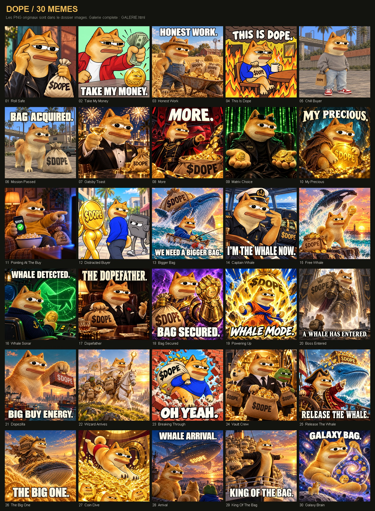
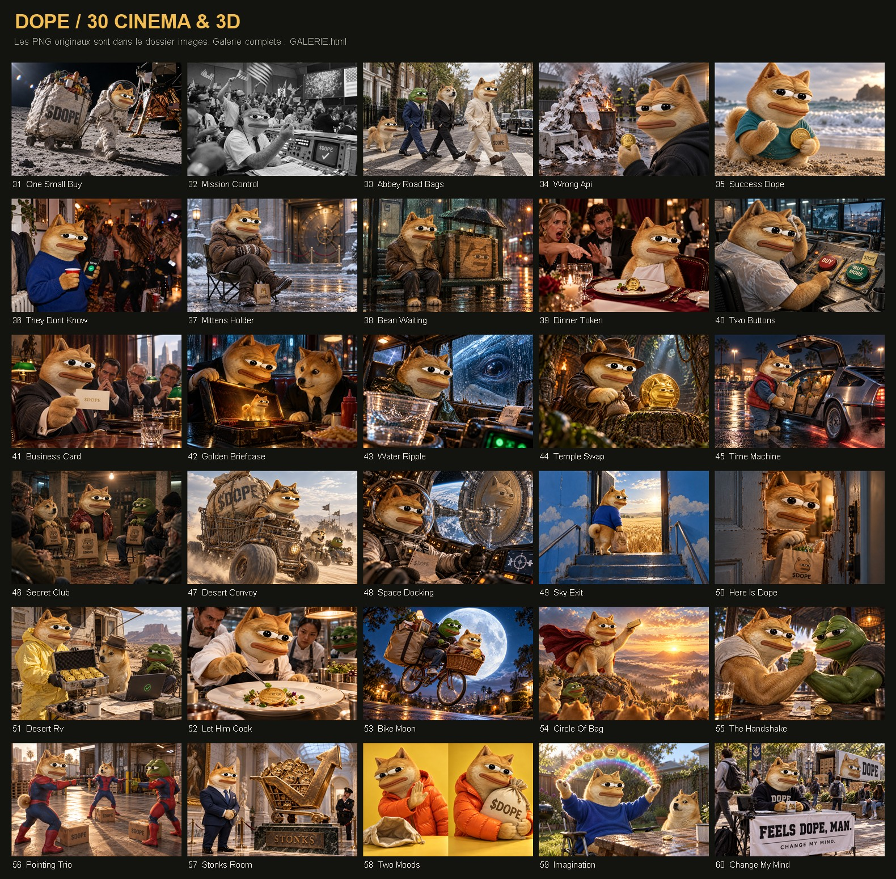

# DOPE — 60 visuels pour les alertes d’achat

30 mèmes carrés et 30 créations cinéma / 3D pour accompagner les tweets d’achat de DOPE.

## Images

- [30 mèmes carrés](DOPE-30-memes/images)
- [30 scènes cinéma / 3D](DOPE-30-cinema/images)
- [Index Hermes des 60 images](index-hermes.json)
- [Guide et crédits](LIRE-MOI.txt)

## Aperçus

### Mèmes

### Cinéma / 3D

## Télécharger sur un autre ordinateur

Cliquez sur **Code → Download ZIP**, puis décompressez le dossier.
Ouvrez **GALERIE.html** pour parcourir les images et filtrer les montants.
Sur un dépôt privé, connectez-vous au compte GitHub autorisé avant de télécharger.

Hermes peut utiliser `index-hermes.json` : chaque entrée contient le chemin relatif
du PNG, une description, une référence de mème et une tranche de montant suggérée.
Les seuils sont modifiables. Le dossier fournit les visuels et les métadonnées ;
la surveillance de la blockchain et la publication sur X restent à connecter.

Les prompts de génération figurent dans chaque collection. Les références de
personnage proviennent de la galerie officielle https://dopeonotc.lol/memes.
Les images 31 et 32 sont des adaptations génératives de photographies NASA ;
leurs crédits sont détaillés dans le guide et dans les métadonnées.
